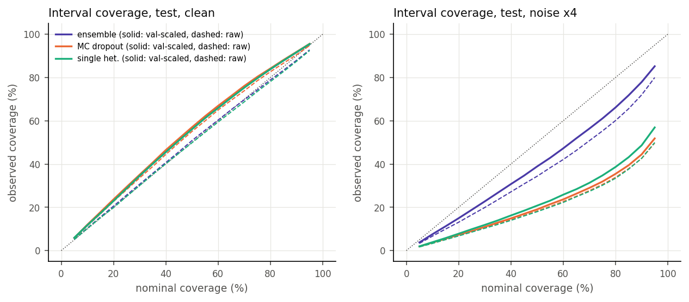
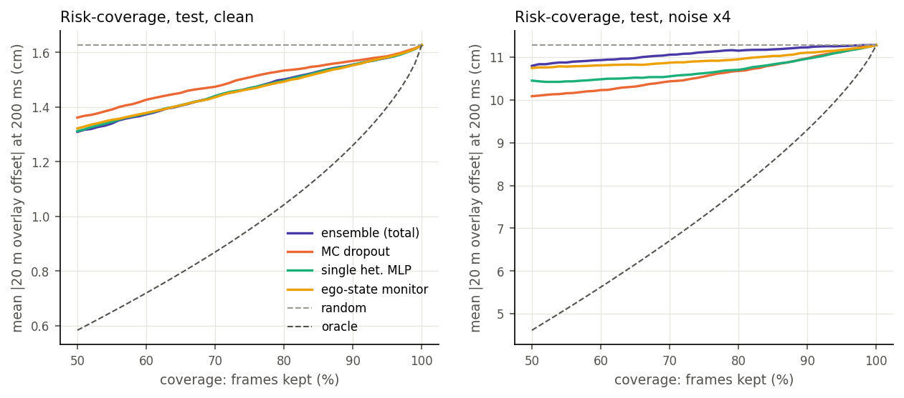

# Uncertainty estimation and a gated fallback for the learned motion predictor

Generated by `scripts/reproduce_unc.py`. Do not edit by hand.

## Question

The EKF + MLP residual hybrid is the most accurate predictor in [MOTION_PREDICTION.md](MOTION_PREDICTION.md) on clean data, and the least robust one under sensor noise. Production dual stacks pair a learned driving model with a classic stack and hand over when the learned part does not know what to do. This study asks the same question at small scale: **which uncertainty signal flags, frame by frame, that the learned prediction is about to fail, and does a fallback to the EKF alone on that signal help on rare manoeuvres and under sensor noise?**

## Setup

- Data: nuScenes CAN bus expansion, split by log (configs/vdyn/split.json). Train 209,215 start points (stride 2), validation 23,637, test 27,715 in 192 scenes (1.04 h).
- Learned model: same inputs and residual targets as `hybrid_mlp` (36 inputs: signal history, past poses, EKF state; 28 outputs). Heteroscedastic heads (mean + log variance per output), Gaussian NLL, Adam, early stopping on the validation NLL. PyTorch on CPU.
- Methods: deep ensemble of 5 members (different seeds); MC dropout (p = 0.1, 30 passes); a single heteroscedastic MLP (ensemble member 0, aleatoric only); and a cheap baseline that uses no model internals, a logistic regression on the ego state (|speed|, |acceleration|, |yaw rate|, |steering| and their recent changes) trained on validation failure labels.
- Monitored quantity: the 20 m overlay offset at the 200 ms horizon (cm). Aleatoric variance is propagated from the residual outputs as var(dy) + 20^2 var(dyaw) (small angle, diagonal); epistemic variance is the spread of the member (or pass) offsets, computed exactly.
- Failure: |offset| of the ensemble mean above **4.67 cm**, the 95th percentile on the clean validation split (so 5 % of clean validation frames are failures by construction). The threshold stays fixed under shift.
- Every scale and threshold comes from the clean validation split: variance scales (NLL-optimal) ens 1.14, MC dropout 1.05, single 1.16; gate thresholds at a 5 % fallback budget on clean validation data.
- Shift: the v0.4.0 noise sweep inputs at 2x and 4x the base noise (pose, wheel speed, yaw rate, acceleration, steering), same random draws; the EKF is told the extra noise, the networks are not (they were trained on clean data).
- Statistics: 95 % percentile bootstrap intervals over test scenes (1,000 resamples).

## Results in short

- Accuracy: the ensemble mean is at 1.63 cm mean |offset| on clean test data vs 1.64 cm for the deterministic v0.4.0 `hybrid_mlp` and 2.78 cm for the EKF alone. Under noise x4: ensemble 11.28 cm, EKF 10.03 cm.
- Failure detection, clean test (AUROC): ensemble total 0.721, MC dropout 0.691, single heteroscedastic 0.724, ego-state monitor 0.716. Ensemble minus ego monitor: +0.005 [-0.015, +0.025].
- Shift detection (AUROC, clean vs noise x4 frames): ensemble total 1.000, epistemic only 1.000, MC dropout 0.986, single heteroscedastic 0.990, ego monitor 0.775. The ensemble's epistemic share of the variance rises from 2 % (clean) to 49 %.
- Calibration under noise x4: calibration error ensemble 0.095, MC dropout 0.287, single 0.268 (clean: 0.041 / 0.045 / 0.040).
- Under noise x4 (failure rate 74.3 % vs 4.3 % clean): ensemble 0.524, epistemic only 0.509, MC dropout 0.556, ego monitor 0.523; difference ensemble - ego +0.001 [-0.009, +0.012].
- Gated fallback on the ensemble's total variance: clean 4.9 % of frames fall back, mean |offset| +0.19 [+0.14, +0.26] cm vs always learned; under noise x4 99.9 % fall back, -1.25 [-1.35, -1.16] cm vs always learned (always EKF: -1.25 [-1.35, -1.16] cm).

## Accuracy (200 ms, 20 m overlay offset, cm)

| condition | EKF alone | EKF + MLP v0.4.0 (MSE) | single het. | ensemble mean | MC dropout mean |
|---|---|---|---|---|---|
| clean | 2.78 / 8.33 | 1.64 / 4.44 | 1.64 / 4.51 | 1.63 / 4.48 | 1.75 / 4.80 |
| noise x2 | 6.26 / 15.78 | 8.73 / 21.36 | 10.22 / 23.68 | 8.28 / 19.42 | 7.27 / 17.57 |
| noise x4 | 10.03 / 24.84 | 12.48 / 30.72 | 14.15 / 34.25 | 11.28 / 27.71 | 11.00 / 27.07 |

mean |offset| / 95th percentile. NLL training costs some mean accuracy against the MSE-trained v0.4.0 model; the ensemble mean recovers part of it.

## Calibration (Gaussian predictive interval of the offset)

| condition | model | NLL raw | NLL scaled | calib. error raw | calib. error scaled | mean sigma (cm, scaled) | epistemic share |
|---|---|---|---|---|---|---|---|
| clean | single het. | -2.446 | -2.455 | 0.008 | 0.040 | 2.24 | - |
| clean | ensemble | -2.456 | -2.462 | 0.008 | 0.041 | 2.22 | 2 % |
| clean | MC dropout | -2.386 | -2.384 | 0.031 | 0.045 | 2.42 | 6 % |
| noise x2 | single het. | 0.414 | -0.030 | 0.251 | 0.213 | 7.11 | - |
| noise x2 | ensemble | -0.723 | -0.805 | 0.107 | 0.065 | 9.08 | 36 % |
| noise x2 | MC dropout | -0.004 | -0.155 | 0.230 | 0.218 | 4.59 | 18 % |
| noise x4 | single het. | 2.806 | 1.769 | 0.298 | 0.268 | 7.37 | - |
| noise x4 | ensemble | -0.214 | -0.369 | 0.134 | 0.095 | 10.85 | 49 % |
| noise x4 | MC dropout | 2.213 | 1.873 | 0.296 | 0.287 | 5.02 | 23 % |

Calibration error = mean |observed - nominal coverage| of the central intervals at 5 ... 95 % (0 = perfect). Scaled = sigma times the NLL-optimal factor from the clean validation split. NLL in log-metres.

## Failure detection (AUROC) and selective prediction

| score | AUROC clean | AUROC noise x2 | AUROC noise x4 | mean at 90 % cov. clean | mean at 90 % cov. noise x2 | mean at 90 % cov. noise x4 |
|---|---|---|---|---|---|---|
| ensemble, total variance | 0.721 | 0.559 | 0.524 | 1.56 | 8.17 | 11.23 |
| ensemble, epistemic only | 0.607 | 0.538 | 0.509 | 1.58 | 8.22 | 11.27 |
| ensemble, aleatoric only | 0.722 | 0.566 | 0.538 | 1.56 | 8.02 | 11.03 |
| single heteroscedastic MLP | 0.724 | 0.576 | 0.540 | 1.56 | 7.95 | 10.96 |
| MC dropout, total variance | 0.691 | 0.573 | 0.556 | 1.57 | 7.98 | 10.97 |
| MC dropout, epistemic only | 0.548 | 0.545 | 0.517 | 1.59 | 8.20 | 11.22 |
| ego-state monitor (logistic regression) | 0.716 | 0.488 | 0.523 | 1.55 | 8.25 | 11.10 |

Failure rates: clean 4.3 %, noise x2 67.2 %, noise x4 74.3 %. The ego-state monitor reaches AUROC 0.694 on the validation split it was trained on. 'mean at 90 % cov.' = mean |offset| (cm) of the 90 % of frames with the lowest score.

## Shift detection (frame level)

| score | AUROC clean vs noise x2 | AUROC clean vs noise x4 |
|---|---|---|
| ensemble, total variance | 0.997 | 1.000 |
| ensemble, epistemic only | 0.999 | 1.000 |
| ensemble, aleatoric only | 0.992 | 0.998 |
| single heteroscedastic MLP | 0.984 | 0.990 |
| MC dropout, total variance | 0.974 | 0.986 |
| MC dropout, epistemic only | 0.986 | 0.997 |
| ego-state monitor (logistic regression) | 0.646 | 0.775 |

The same test frames scored once clean and once with input noise; AUROC of the score for 'this frame is noisy'. Per-frame failure ranking inside a shifted condition is weak for every score (table above), because most frames fail; what the variance does carry is the condition itself.

## Rare manoeuvres (clean test)

| slice | frames | failure rate | AUROC ens. | AUROC MCD | AUROC ego | ens. mean (cm) | EKF (cm) | gated (cm) | fallback |
|---|---|---|---|---|---|---|---|---|---|
| low speed (< 5 m/s) | 9,385 | 2.8 % | 0.831 | 0.807 | 0.819 | 1.34 | 3.12 | 1.78 | 8.9 % |
| yaw-rate change (turn in / out) | 665 | 8.6 % | 0.695 | 0.660 | 0.668 | 2.09 | 8.34 | 3.42 | 14.6 % |
| steady curve | 1,138 | 3.6 % | 0.586 | 0.570 | 0.621 | 1.73 | 3.29 | 1.88 | 11.7 % |
| braking | 571 | 3.0 % | 0.823 | 0.820 | 0.671 | 1.60 | 2.03 | 1.59 | 0.9 % |
| accelerating | 542 | 2.6 % | 0.723 | 0.690 | 0.710 | 1.50 | 2.67 | 1.56 | 1.5 % |
| straight, steady | 9,779 | 5.2 % | 0.638 | 0.665 | 0.631 | 1.80 | 2.25 | 1.81 | 1.4 % |
| other | 5,635 | 4.9 % | 0.683 | 0.685 | 0.670 | 1.75 | 2.45 | 1.77 | 2.6 % |

Slices as in MOTION_PREDICTION.md (labels from the recorded motion over the next 0.5 s; first match wins).

## Gated fallback to the EKF

**clean**

| policy | fallback | mean (cm) | p95 (cm) | failure rate | mean vs always learned (cm, 95 % CI) |
|---|---|---|---|---|---|
| always learned (EKF + MLP ensemble) | 0.0 % | 1.63 | 4.48 | 4.3 % | +0.00 [+0.00, +0.00] |
| always EKF | 100.0 % | 2.78 | 8.33 | 16.7 % | +1.15 [+1.03, +1.28] |
| gate on ensemble, total variance | 4.9 % | 1.82 | 5.04 | 6.0 % | +0.19 [+0.14, +0.26] |
| gate on ensemble, epistemic only | 5.3 % | 1.89 | 5.33 | 6.7 % | +0.26 [+0.20, +0.33] |
| gate on MC dropout, total variance | 6.4 % | 1.98 | 5.86 | 7.6 % | +0.36 [+0.28, +0.44] |
| gate on ego-state monitor (logistic regression) | 2.0 % | 1.73 | 4.71 | 5.1 % | +0.10 [+0.07, +0.14] |

**noise x2**

| policy | fallback | mean (cm) | p95 (cm) | failure rate | mean vs always learned (cm, 95 % CI) |
|---|---|---|---|---|---|
| always learned (EKF + MLP ensemble) | 0.0 % | 8.28 | 19.42 | 67.2 % | +0.00 [+0.00, +0.00] |
| always EKF | 100.0 % | 6.26 | 15.78 | 54.2 % | -2.02 [-2.13, -1.89] |
| gate on ensemble, total variance | 98.8 % | 6.26 | 15.77 | 54.2 % | -2.02 [-2.14, -1.89] |
| gate on ensemble, epistemic only | 99.5 % | 6.26 | 15.76 | 54.2 % | -2.02 [-2.14, -1.89] |
| gate on MC dropout, total variance | 90.3 % | 6.38 | 15.96 | 55.2 % | -1.89 [-2.00, -1.77] |
| gate on ego-state monitor (logistic regression) | 13.9 % | 8.11 | 19.03 | 66.5 % | -0.17 [-0.21, -0.12] |

**noise x4**

| policy | fallback | mean (cm) | p95 (cm) | failure rate | mean vs always learned (cm, 95 % CI) |
|---|---|---|---|---|---|
| always learned (EKF + MLP ensemble) | 0.0 % | 11.28 | 27.71 | 74.3 % | +0.00 [+0.00, +0.00] |
| always EKF | 100.0 % | 10.03 | 24.84 | 70.6 % | -1.25 [-1.35, -1.16] |
| gate on ensemble, total variance | 99.9 % | 10.03 | 24.84 | 70.5 % | -1.25 [-1.35, -1.16] |
| gate on ensemble, epistemic only | 100.0 % | 10.03 | 24.84 | 70.6 % | -1.25 [-1.35, -1.16] |
| gate on MC dropout, total variance | 96.4 % | 10.05 | 24.94 | 70.5 % | -1.23 [-1.32, -1.13] |
| gate on ego-state monitor (logistic regression) | 37.4 % | 10.89 | 26.57 | 73.4 % | -0.39 [-0.46, -0.33] |

## Cost

| model | p50 (us) | p99 (us) |
|---|---|---|
| single heteroscedastic MLP | 128 | 155 |
| deep ensemble, 5 members | 525 | 567 |
| MC dropout, 30 passes | 3032 | 3165 |

One prediction, batch of 1, PyTorch 2.8.0+cpu on 1 CPU thread (Python overhead included; not the C++ path of stack/mpred). Training: ensemble 1.8 min, MC dropout 0.8 min on 16 threads.

## Limits

- Open-loop ego motion prediction on 192 test scenes of one vehicle (Renault Zoe, Boston and Singapore), not an end-to-end driving model and not closed-loop planning.
- The noise shift is synthetic (white Gaussian on the inputs) and therefore easy to detect (even the ego-state monitor separates it); real sensor faults are structured and subtler. The shift-detection AUROCs are an upper bound.
- The aleatoric propagation to the overlay offset is a small-angle, diagonal approximation.
- The failure threshold is the 95th percentile of the clean validation error, a choice; other thresholds change the AUROCs.
- Seeds fixed (20261011); one training run per model, no seed-to-seed spread reported.

Environment: Python 3.11.16, PyTorch 2.8.0+cpu, numpy 2.4.6; full run 3.3 min.
